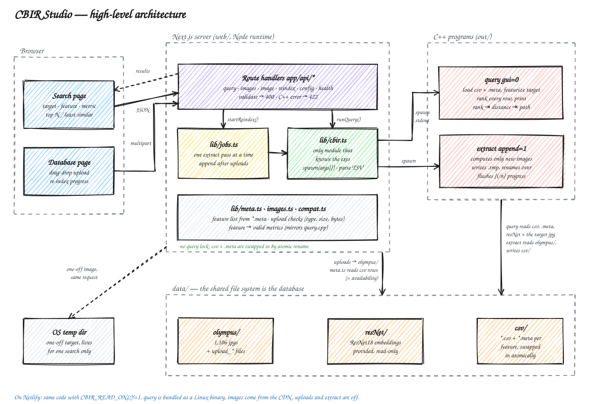

# Architecture

How the two C++ programs and the web UI fit together, why it is built this way, and where it stops
scaling. For build commands see [BUILD.md](BUILD.md); for hosting see [DEPLOYMENT.md](DEPLOYMENT.md).



<sub>Editable source: [docs/architecture.excalidraw](docs/architecture.excalidraw) (open it at
[excalidraw.com](https://excalidraw.com) → Open).</sub>

## Overview

The system has three layers. Each one can be used without the layers above it.

| Layer | What it is | Owns |
|---|---|---|
| **C++ programs** (`src/`, built to `out/`) | `extract` turns every image into a feature vector. `query` ranks the database against a target. | All feature and distance math |
| **Data** (`data/`) | Plain files: images, one `csv` + `.meta` per feature, the provided ResNet18 embeddings | Persistent state (the file system is the database) |
| **Web app** (`web/`) | Next.js pages, plus route handlers that run the C++ programs | Validation, uploads, job control, presentation |

The main rule: **the web app never computes a feature or a distance.** Every ranking is a `query` run, and
every re-index is an `extract` run. That's why web results match the command line exactly. The README
results table is reproduced through the UI.

## The C++ side

```
            offline, once per feature                  online, per target
 data/olympus/*.jpg ──► extract ──► data/csv/<feature>.csv + .meta ──► query ──► ranked list
                                                                       ▲
                                              target image ────────────┘
```

- **Two programs, so the slow step runs once.** `extract` reads all 1,106 images (about 15 s for
  `texture_color` in Release). `query` only reads the csv and featurizes the target.
- **The `.meta` file is the contract between them.** It records the feature type, `bins` and `patch`. `query`
  computes the target with exactly those settings and refuses a csv that has no `.meta`. Without it, a
  16-bin target could silently be compared against 8-bin rows.
- **Paths in csv files are relative to `data/`**, so a feature file doesn't depend on where the project is.
- **Flags added for the web app:**
  - `query gui=0` prints the results and exits instead of opening the results window.
  - `extract` flushes its `[i/n]` progress lines, because piped stdout is fully buffered.

| C++ file | Purpose |
|---|---|
| `src/extract.cpp`, `src/query.cpp` | The two programs |
| `src/features.cpp`, `include/features.h` | Feature extractors and their status codes |
| `src/sobel.cpp`, `include/sobel.h` | Sobel X/Y and gradient magnitude (reused from Project 1) |
| `src/metrics.cpp`, `include/metrics.h` | Distance metrics |
| `src/feature_store.cpp`, `include/feature_store.h` | Saving and loading feature files with their `.meta` |
| `src/display.cpp`, `include/display.h` | The scrollable results window |
| `src/common.cpp`, `include/common.h` | `key=value` argument parser |
| `src/csv_util.cpp`, `include/csv_util.h` | CSV reading and writing provided with the assignment (unchanged) |

## The web side

| Web file | Responsibility |
|---|---|
| `web/lib/cbir.ts` | **The only module that knows the programs exist.** Builds the argument arrays, spawns the programs, parses the `rank ⇥ distance ⇥ path` output, and reports `extract` progress. |
| `web/lib/jobs.ts` | Runs one `extract` pass at a time: `append` after uploads, `full` from the Rebuild button. An upload that arrives during a run queues exactly one more pass. Queries are never blocked. |
| `web/lib/meta.ts` | Lists features from `data/csv/*.meta`, so a new csv shows up in the UI without code changes. Also reads which images each csv has a row for (cached by file mtime). That's the source of truth for availability. |
| `web/lib/images.ts` | Lists the database, validates uploads (extension, 10 MB limit, JPEG/PNG magic bytes), and stores one-off targets. |
| `web/lib/compat.ts` | The feature → valid metrics table and the API types. It is shared by client and server. |
| `web/lib/paths.ts` | `CBIR_ROOT` resolution and the path-traversal guard. |
| `web/app/api/*/route.ts` | Thin HTTP layer: `config`, `images`, `image`, `targets`, `query`, `reindex`. |
| `web/components/*` | Search and Database views (shadcn/ui on Base UI, Tailwind). |

### Request flows

**Search** (`POST /api/query`):

1. The request is validated:
   - `featureId` must be in the list built from the `.meta` files.
   - The metric must be valid for that feature.
   - `top` must be 1–100 and `worst` 0–50.
   - The target must exist.
   - For a feature that reads the target's vector from the index (`dnn`, `orange_dnn`), the target must have a row in it.
2. `query` is spawned with an argument array (never a shell string) and a 30 s timeout.
3. stdout is parsed. Lines without tabs, such as the "Reading …" output from csv_util, are skipped. Each row is mapped to a name and an `/api/image?p=…` URL.
4. The response is `{ matches, worst, elapsedMs, command, unindexed }`.
   - `command` is the exact CLI invocation, so any result can be reproduced in a terminal.
   - `unindexed` counts database images with no row for this feature, so the UI can say they're missing from the ranking instead of dropping them silently.

**Upload to the database** (`POST /api/images`, multipart):

1. Each file is checked, then written to `data/olympus/upload_<epoch-ms>_<slug>.<ext>`. The `wx` flag means an existing file is never overwritten.
2. `startReindex("append")` runs `extract append=1` once for each `.meta`, with the parameters stored in that `.meta`. Each run computes only the new image. All six features take about 7 s in total, most of it process start-up and reading the CSVs.
3. The UI polls `GET /api/reindex` (every 1.2 s while running, 8 s when idle) to show progress. The image's availability updates as each csv is swapped in.

**Availability** (which features an image can be searched with): each image in `GET /api/images` carries
`missing`, the feature ids whose csv has no row for it. It is read from the csv files themselves, so it can't
disagree with what `query` searches. One rule covers every image, original or uploaded:
`usable(f) = !f.targetFromIndex || !image.missing.includes(f.id)`. Pixel features work for any target because
`query` computes the target's vector from the image file. The two ResNet features need the target's own row.

**One-off target** (`POST /api/targets`, then `POST /api/query`): the image is saved to `data/tmp/<uuid>.<ext>`. That folder isn't scanned by `extract`, so the image is never indexed. Files older than 24 h are deleted.

## Design decisions and trade-offs

### 1. Run the C++ programs as subprocesses rather than porting or embedding them

| Option | Pros | Cons |
|---|---|---|
| **Subprocess per request (chosen)** | No changes to the feature code, and results match the CLI exactly. A crash only kills the child process. | About 300 ms per query to start the process and reload the csv. The programs must exist for the server's OS. |
| Native Node addon (N-API) | Runs in-process, so it's fast | node-gyp plus OpenCV on Windows is fragile, and a segfault takes down the whole server |
| Long-lived C++ HTTP service | Fastest: vectors stay in memory | A second server to write and run |
| Rewrite the features in TS/Python | Single language | Two implementations that will drift apart, which defeats the assignment |

At 1.1k rows, 300 ms is not noticeable. If that changes, swapping `lib/cbir.ts` for a client of a long-lived
service touches one file.

### 2. The file system is the database

csv + `.meta` files are what the CLI already reads and writes, so the CLI and the web app always agree. The
cost: no transactions, one writer at a time, a whole-file rewrite per change, and a single machine.

### 3. Incremental indexing with `extract append=1`

The first version re-ran `extract` over the whole folder after every upload. That was O(N) per upload: about
56 s for six features on 1,107 images. `append=1` loads the existing csv, computes only the images that have
no row, and drops rows for images that are gone. It then writes the result in the folder's sorted order, so
the file is **byte-identical to a full run**. That was verified with `cmp`, and the parameters can't drift
because the csv name encodes `bins`/`patch`. It still rewrites the whole file, which costs O(N) in I/O, but
the feature computation is O(new images). The Rebuild button still does a full run, which is needed when the
feature code itself changes.

### 4. Atomic file swaps instead of a query lock

`saveFeatures` writes `<name>.csv.tmp` and `<name>.meta.tmp` in full, then renames each over the old file. A
concurrent `query` reads either the old version or the new one, never a partial file. That replaced a lock
that refused queries (409) for a minute after every upload. Two edges:

- **The pair isn't swapped in one step.** Between the csv rename and the `.meta` rename, the row counts
  disagree. `loadFeatures` retries a mismatch a few times (about 0.5 s) before treating it as real.
- **Windows refuses to replace a file another process has open.** The rename is retried for up to about
  5 s, which is longer than any query takes.

Tested: 60/60 queries returned the correct result while `extract` rewrote the same csv three times.

### 5. Job state lives in process memory

`jobs.ts` keeps its state on `globalThis`, so it survives dev hot reloads but not a server restart. It also
assumes **one server process**. Two instances would each run their own `extract` against the same files.
That's fine for a local tool. Running more than one instance would need a real queue and a lock.

### 6. The UI derives valid choices; the C++ has the final say

`compat.ts` mirrors the feature/metric checks in `query.cpp`, so invalid combinations are disabled before a
request is sent. That duplication is deliberate, for user experience. When the two disagree, `query`'s error
message is passed through as a 422 response.

### 7. DNN features only cover the original images

The ResNet18 embeddings were provided as a csv. There is no network in the project to compute new ones, so
uploaded and one-off images can't use `dnn` or `orange_dnn`. The UI disables those options and the API
rejects them. This falls out of the availability rule above, with no special case for uploads.
**To fix:** load an ONNX ResNet18 with `cv::dnn` inside `extract`. First re-embed the 1,106 originals and
check that cosine similarity to the provided rows is about 1.0. Otherwise the new vectors live in a
different space.

### 8. Security posture (local tool)

- Programs are started with argument arrays, never through a shell.
- Feature ids must match a listed `.meta` file.
- Image names must match `^[\w.-]+$`.
- `/api/image` only serves image files under `data/`. `?p=../CMakeLists.txt` returns 400.
- Uploads are checked by extension, size and magic bytes.
- There is **no authentication**, which is fine on localhost and not fine on a public URL.

## What breaks at scale

| Pressure | First thing to break | Fix |
|---|---|---|
| 100k+ images | Each query re-parses a csv of hundreds of MB, and even `append=1` rewrites that whole file per upload | Long-lived service with the vectors in memory (or `mmap`), a store that supports upsert, and an approximate nearest-neighbour index (e.g. HNSW) instead of a full scan |
| Many uploads at once | One `extract` pass at a time, each rewriting the whole csv | Batch uploads into one pass (already done: one queued pass covers everything that arrived), or move the vectors to a database (e.g. Postgres + pgvector) |
| Multiple server instances | In-memory job state, files on local disk | A job queue, plus object storage for images |
| Serverless hosting | Read-only file system, no background work after the response is sent, each request may run on a different instance | See [DEPLOYMENT.md](DEPLOYMENT.md): a read-only deployment, or a host with a persistent disk |
