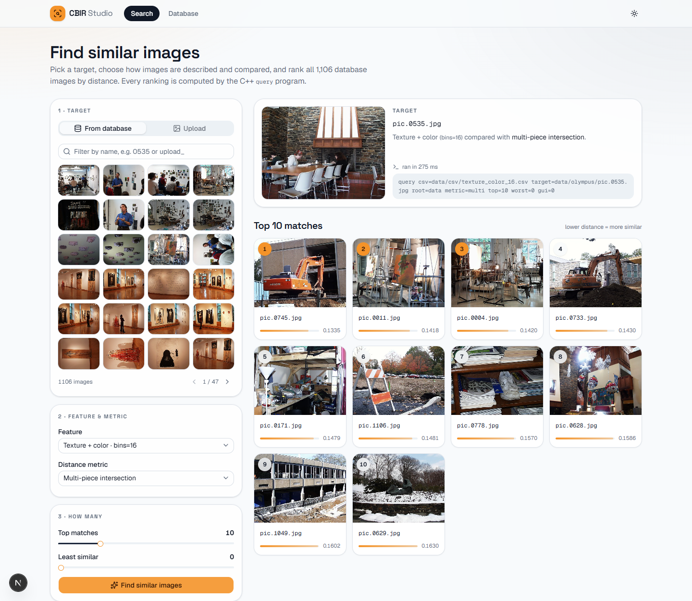

# Content-based Image Retrieval

Given a target image and a database of images (`data/olympus`, 1,106 photos), find the images most
similar to the target. The project has three parts:

- **`extract`** (C++/OpenCV) computes one feature vector per database image and saves them to a csv,
  with a `.meta` file describing how they were made.
- **`query`** (C++/OpenCV) ranks every image by distance to a target and shows the best and least similar
  matches in a scrollable results window.
- **Web UI** (`web/`, Next.js) does the same from a browser, and can add new images to the database. It
  runs the two programs above, so its results are identical to the command line.

**Live demo:** <https://content-based-image-retrieval.netlify.app>. This is a read-only search over the
1,106 images. Adding images works when you run it locally.

| Doc | Contents |
|---|---|
| [BUILD.md](BUILD.md) | Building the C++, the `extract`/`query` reference, exact commands for every task, building and running the web UI |
| [ARCHITECTURE.md](ARCHITECTURE.md) | Diagram, how uploads and searches work, design decisions, what breaks at scale, roadmap |
| [DEPLOYMENT.md](DEPLOYMENT.md) | Deploying the web UI to Netlify as a read-only search demo: the three scripts, the checks, and what broke on the first deploy |

## Quick start

Windows 11, MSVC, CMake ≥ 3.15 and OpenCV 5 are needed. Full details are in [BUILD.md](BUILD.md).

```
cmake -S . -B build && cmake --build build --config Release
./out/extract.exe db=data/olympus feature=texture_color bins=16
./out/query.exe csv=data/csv/texture_color_16.csv target=data/olympus/pic.0535.jpg metric=multi top=3

cd web && npm install && npm run dev     # web UI at http://localhost:3000
```

## Web UI



- **Search:**
  - **Target:** pick one from the database, or use a one-off image. A one-off image is sent with each
    search and never stored.
  - **Feature:** every feature file in `data/csv`, plus the provided ResNet18 embeddings.
  - **Metric:** only the ones that make sense for the chosen feature.
  - **Info icons:** the ⓘ next to Feature and Metric explain, in two lines, how the current choice works.
  - **How many:** set the number of top matches and least-similar images.
  - **Results:** ranked tiles with distance bars, plus the exact `query` command that produced them. Any
    result can become the next target.
- **Database:**
  - Browse the images and drag in new ones.
  - New images are indexed in the background by `extract append=1`, which computes only what's missing. All
    features take a few seconds, and searching keeps working throughout.
- **Limitation:** the ResNet18-based features need a provided embedding, so they only work with the
  original 1,106 images as the target.

How uploads work, step by step, is in [ARCHITECTURE.md](ARCHITECTURE.md#how-uploads-work).

## Tasks and results

Commands for each task are in [BUILD.md](BUILD.md#commands-for-each-task).

| Task | Feature; metric | Target | Top three |
|---|---|---|---|
| 1 Baseline | 7x7 center patch; SSD | `pic.1016` | 0986, 0641, 0547 (4th: 1013), as in the reference result |
| 2 Histogram | rg chromaticity, 16 bins; intersection | `pic.0164` | 0080, 1032, 0461 |
| 3 Multi-histogram | top/bottom halves + center; multi | `pic.0274` | 0409, 1055, 0275 |
| 4 Texture + color | rg + Sobel magnitude; multi | `pic.0535` | 0745, 0011, 0004 |
| 5 DNN embeddings | ResNet18; cosine | `pic.0893`, `pic.0164` | 0897, 0136, 0146 and 1032, 0213, 0690 |
| 6 DNN vs classic | ResNet18 vs histogram / multi-histogram | `pic.0948`, `pic.1072`, `pic.0734` | see the report |
| 7 Custom | orange object + ResNet18; custom | `pic.0323` (mask), `pic.0281` (basketball) | see the report |

### Task 7: custom design

Goal: find photos that contain one specific, strongly orange object (an orange mask, with a basketball as
a second test).

- **Feature:** the 512-value ResNet18 embedding, followed by a 32-value histogram (8 hue × 4 saturation
  bins). The histogram counts only strongly orange pixels: hue 4–35°, saturation and brightness ≥ 0.6.
  That way it records the object's shade and ignores the background.
- **Distance:** `0.7 × cosine(embedding) + 0.3 × (1 − intersection(orange shade))`.

## Extensions

- **Results window:** a wrapped, scrollable grid of labeled matches. Run any query with `top=12` or more to see it scroll.
- **Least similar results:** `worst=N` also shows the N images farthest from the target.
- **Custom feature (Task 7)**, described above.
- **Web UI:** search from the browser and add images to the database, deployed as a read-only demo. The
  design is in [ARCHITECTURE.md](ARCHITECTURE.md) and the hosting in [DEPLOYMENT.md](DEPLOYMENT.md).
